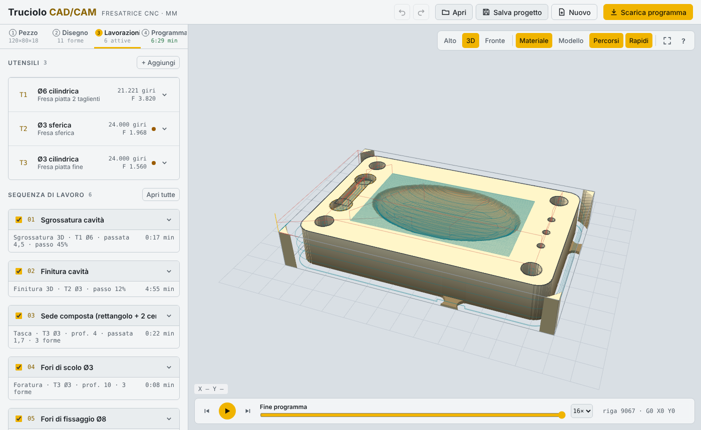
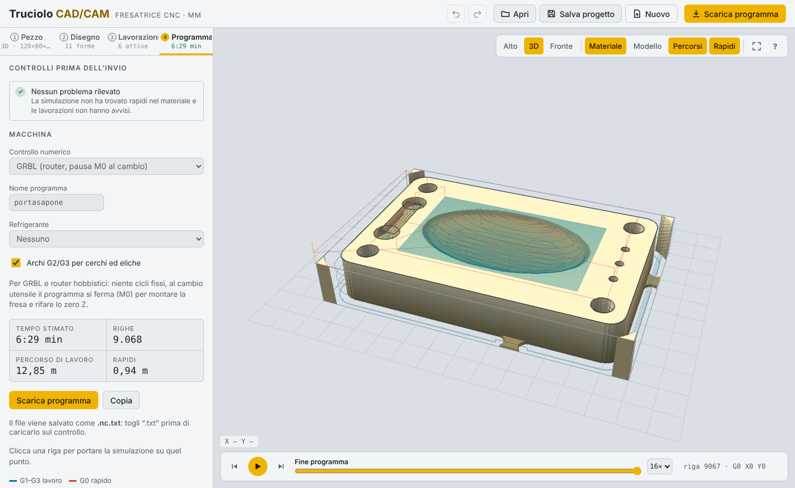

# Truciolo CAD/CAM

CAD/CAM per fresatrici CNC che funziona interamente nel browser: carichi il pezzo, imposti utensili e lavorazioni, controlli la simulazione dell'asportazione e scarichi il programma per la macchina. Nessuna installazione e nessun server: tutto il calcolo avviene sul tuo computer.



## Cosa fa

**Importazione**
- 3D: STEP, IGES, BREP (motore OpenCascade in WebAssembly), STL, OBJ, PLY
- 2D: DXF (linee, archi, cerchi, polilinee con raccordi, spline, ellissi) e SVG
- Progetti Truciolo (`.truciolo.json`) con modello, disegno, utensili e lavorazioni

**Pezzo e grezzo**
- Scelta della faccia d'appoggio cliccando sul modello, rotazioni, scala e conversione da pollici
- Grezzo a blocco o sagoma da taglio laser, con sovrametallo solo sulle superfici di bordo scelte
- 12 materiali (legni, MDF, plastiche, alluminio, ottone, acciai) che guidano i dati di taglio suggeriti
- Riconoscimento automatico di fori, tasche (anche a gradini e con isole) e ribassi esterni

**Disegno 2D**
- Linee, polilinee, rettangoli con raccordo e cerchi, con aggancio a griglia e ai punti notevoli
- Spostamento trascinando o con le frecce, duplicazione, quote modificabili con calcoli (`18+0,3`)

**Utensili**
- Frese cilindriche, sferiche, toriche, coniche, punte a forare, spianatori e frese a inserti
- Materiali HSS, metallo duro, inserti in metallo duro, cermet e PCD
- Giri e avanzamenti calcolati da numero di denti, avanzamento per dente e velocità di taglio, con limiti del mandrino

**Lavorazioni**
- Spianatura, contorno (con ponticelli), tasca (unione di forme o isole), foratura a tratti o elicoidale
- Sgrossatura e finitura 3D
- Contornatura del sovrametallo per pezzi da taglio laser

**Simulazione e controlli**
- Asportazione del materiale sul grezzo, con avviso se un rapido entra nel pezzo
- Simulazione della singola lavorazione, salto tra lavorazioni, clic su una riga del programma per vederla
- Elenco dei controlli prima dell'invio

**Programma per la macchina**

| Controllo | Caratteristiche |
|---|---|
| GRBL | router hobbistici, pausa M0 al cambio utensile |
| LinuxCNC / Mach3 | T… M6, G43 H, cicli G81/G83 |
| Fanuc | `%`, numero O, punto decimale su tutte le quote, G28 al cambio, G43 H, cicli G81/G83 modali |
| Heidenhain TNC | dialogo in chiaro: BLK FORM, TOOL CALL, L/CC/C, ciclo 200 con M99 |

Per tutti: archi G2/G3 (o CC/C), refrigerante, tempo ciclo stimato.



## Come si usa

Il lavoro segue le quattro schede:

1. **Pezzo** – apri il file, scegli la faccia d'appoggio, il materiale e il grezzo. Con un modello 3D puoi far riconoscere fori e tasche.
2. **Disegno** – disegna o correggi le forme 2D da lavorare.
3. **Lavorazioni** – imposta gli utensili e la sequenza di lavoro. I valori suggeriti si aggiornano finché non li modifichi.
4. **Programma** – scegli il controllo, verifica i controlli e scarica il file.

Zero pezzo: X0 Y0 all'angolo anteriore sinistro del grezzo, Z0 sulla faccia superiore.

Comandi principali: Ctrl+Z / Ctrl+Y annulla e ripeti, Spazio avvia la simulazione, F adatta la vista, `?` mostra tutti i comandi.

Il progetto si salva da solo nel browser (anche il modello 3D) e si può esportare con **Salva progetto**.

## Avvio

Il programma è una pagina statica:

- **GitHub Pages**: in *Settings → Pages* scegli il ramo `main` e la cartella principale; l'app sarà su `https://kain986.github.io/truciolo-cadcam/`.
- **In locale**: serve un piccolo server web, perché il motore STEP/IGES si carica come file separato. Ad esempio `python3 -m http.server` nella cartella del progetto, poi apri `http://localhost:8000`.

Serve una connessione a internet solo per la libreria grafica three.js e i caratteri, caricati da CDN.

## Struttura

```
index.html                  interfaccia, vista 3D, simulazione
lib/cam.js                  motore CAM: percorsi utensile, riconoscimento, postprocessori, lettori di file
lib/clipper.js              offset e operazioni booleane sui poligoni
lib/occt-import-js.*        lettura STEP/IGES/BREP (OpenCascade compilato in WebAssembly)
```

## Avvertenze

Truciolo è un prototipo. Prima di lavorare un pezzo controlla sempre il programma nella grafica del controllo o in un simulatore, e fai una prova in aria. I dati di taglio suggeriti sono valori di partenza indicativi: verificali con le indicazioni del produttore degli utensili.

## Librerie di terze parti

- [three.js](https://threejs.org) – licenza MIT (caricata da CDN)
- [Clipper](http://www.angusj.com/delphi/clipper.php) di Angus Johnson – Boost Software License 1.0 (vedi intestazione di `lib/clipper.js`)
- [occt-import-js](https://github.com/kovacsv/occt-import-js) e [Open CASCADE Technology](https://www.opencascade.com) – LGPL 2.1 (vedi `lib/LICENSE.occt-import-js.txt` e `lib/LICENSE.opencascade.txt`)
